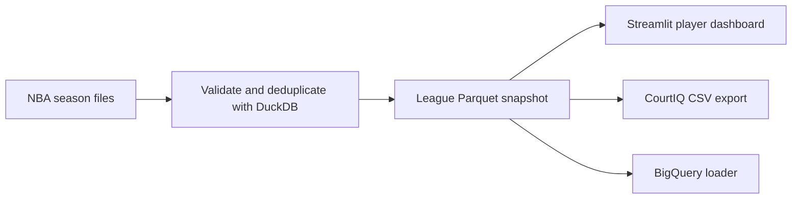

# NBA Cloud Data Platform

[**Open the player dashboard**](https://anthony-edwards-pipeline-by-mt.streamlit.app/)

I started this project with a pipeline for Anthony Edwards' game logs. I expanded it to the whole league so I could use the same dataset for a player dashboard and for CourtIQ. Steph Curry opens the dashboard. You can switch to Kevin Durant, Anthony Edwards, Luka Dončić, or look up another player by NBA ID.

CourtIQ estimates a player's next box score. This project handles the work that comes before a model can do that. It collects completed games, checks that the data makes sense, and publishes it in a form other applications can use.

## What the pipeline does



I pull regular-season box scores from the [nba_data archive](https://github.com/llimllib/nba_data), which publishes NBA Stats data in season files. The included snapshot covers **5,100 games, 934 players and 109,304 player appearances** from October 18, 2022 through November 13, 2026. The 2026–27 season is still in progress.

One row represents one player appearing in one game. A player who misses a game contributes no appearance. The other players' records still count. When the archive has no home/away flag, the export keeps the teams and leaves the venue unspecified.

The pipeline checks that every expected season is present and rejects impossible box-score values, future dates, conflicting records, and refreshes that drop previously published appearances. It writes a temporary file and replaces the published snapshot only after the checks pass. A repeated load rebuilds the same dataset instead of appending another copy of every game.

## Run it locally

Use Python 3.11.

```bash
python -m venv .venv
source .venv/bin/activate
python -m pip install -r requirements.txt
python -m streamlit run dashboard.py
```

The dashboard reads the included snapshot. The season selector changes the averages, scoring chart, table, and downloadable CSV. The date at the top shows how current the snapshot is.

## Refresh and export

```bash
python -m warehouse.pipeline
python -m warehouse.export --output /tmp/courtiq.csv
python -m unittest discover -s tests -v
```

The refresh can also use local files named `2023.parquet` through `2027.parquet` with `--archive-dir`. I ran the same five files through the pipeline twice and got the same SHA-256 hash and row count. I also verified that CourtIQ's snapshot reader accepts the resulting 1,281-row export. CourtIQ's deployed training and data remain managed in its own repository.

The **Refresh NBA warehouse** GitHub Actions workflow runs daily and can be started manually. It validates the new snapshot before committing it. A rejected refresh leaves the previous snapshot available to the dashboard.

## BigQuery deployment

The Streamlit dashboard currently queries the published Parquet file with DuckDB. The BigQuery loader is included for a separately provisioned Google Cloud project. It loads the validated player table, partitions it by game date, clusters by player and team, and creates a games view.

After creating a dataset and configuring Google Cloud application credentials with permissions to load data and create views, run:

```bash
python -m pip install -r requirements-cloud.txt
python -m warehouse.bigquery_load --project YOUR_PROJECT_ID --dataset nba
```

The live Google Cloud load requires an authorized project. The dashboard and refresh run independently of that connection.

The original Anthony Edwards version is preserved in this repository's commit history.
